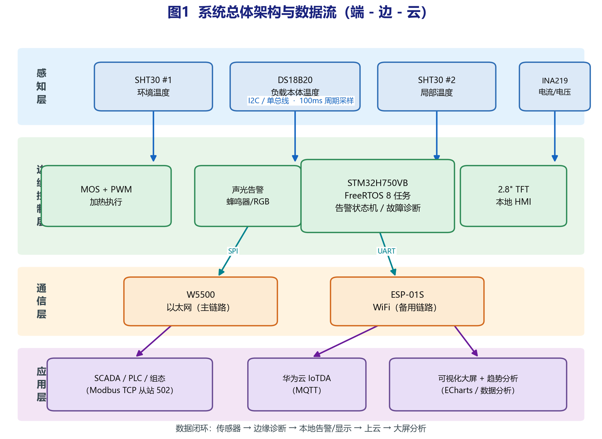

# Cabinet Guardian

控制柜状态监测与故障诊断系统。以 STM32H750 为边缘节点，采集柜内温度、
加热回路电流和加热输出占空比，在本地完成故障识别和分级告警，
通过 Modbus TCP / MQTT 对上位机通信。

当前状态：开发板已到位（正点原子 MiniPro STM32H750 V1.5），固件在板上跑通到 P0b。
已完成并实板验证：工具链（MDK + SWD 调试）、串口、GPIO、SD 卡（SDMMC1 四位 + FatFs）、
心跳日志追加写入；算法层在 PC 上通过 11 项验证。
下一步：ILI9341 SPI 屏驱动，随后 QSPI 启动与字库写入。

固件占用：Flash 27.5 KB / 128 KB，RAM 3.6 KB。



## 为什么不用温度阈值报警

电气柜监测的常规做法是给温度设一个上限，超了报警。这个做法有两个问题：
报警时故障已经成立，而且分不清是哪一类故障。

温度升高的原因至少有三种：

- 加热负载在工作，温度本来就该升
- 散热通道出了问题，热量没散出去
- 温度探头本身漂移了

只看温度值区分不了这三种情况。但同时看电流就可以：电流正常说明负载确实在耗电，
那么温升速度应该落在由功率决定的一个范围内。实测温升明显快于这个范围，
是散热异常；实测温升几乎为零而电流正常，是热偶/导热路径断开；
两路温度探头读数差距过大，是探头漂移。

这就是本项目的基本思路——用不同物理量的信号互相印证，
而不是给单个信号设阈值。算法详见 `code/App/diagnose.c`。

## 故障判据

| 编号 | 判据 | 判据含义 | 触发动作 |
|---|---|---|---|
| 1 | `duty > 0 && I < 0.05A` 持续 2s | 加热回路断路（加热丝断、端子松、保险熔断、温控开关动作） | 停止输出，锁存 |
| 2 | `I > 2.5A` | 过流或短路 | 立即切断，锁存 |
| 3 | `duty == 0 && I > 0.05A` | MOS 管击穿直通 | 报警，锁存 |
| 4 | 两路温度均 > 45°C 且 \|ΔT\| > 5°C | 温度探头漂移 | 降级为单探头工作 |
| 5 | 实测 dT/dt − 模型预测 dT/dt > 0.5 °C/s | 散热异常 | 报警 |
| 6 | d(R)/dt > 0.05 Ω/s，R = U/I | 加热元件阻值漂移（老化） | 趋势预警 |

判据 5 用得是一阶热模型残差，不是给温升速率设固定阈值：

```
模型预测温升速率 = (Pmax × 占空比 − k·(T − Tamb)) / C
残差 = 实测温升速率 − 模型预测温升速率
```

其中 C 是负载热容，k 是散热系数。固定阈值在物理上不成立——10W 加热一个
9 J/K 的负载，正常温升速率本来就有 0.5 度每秒左右，任何"超过某个速率就报警"
的判据都会误报。用模型做基准才有意义。

C 和 k 需要实测辨识：给恒定功率，记录温度曲线，拟合即可。

## 告警状态机

三个温度告警级别加一个故障锁存态：

```
NORMAL ──> WARN ──> ALARM ──> EMERGENCY
   <──       <──       <──
   40°C      55°C      60°C

任一硬件故障 ──> FAULT（锁存，需人工复位）
```

几个设计上的取舍：

- 向上迁移需要连续 3 秒确认，滤掉单点毛刺
- 向下恢复按迟滞阈值（40/55°C），避免在阈值附近反复跳变
- EMERGENCY 不去抖，安全侧动作必须立即执行
- FAULT 是锁存态。硬件故障（比如 KSD9700 温控开关动作）之后如果自动恢复输出，
  会出现"关断—冷却—复通—再关断"的打嗝循环，必须人工确认后才能重新使能

## 加热控制

用 1Hz 时间比例，不用 kHz 级 PWM。原因：

- INA219 在脉冲电流下采样会失真，必须在导通期稳定采样
- 10W 水泥电阻的热时间常数是几十秒，高频调制没有意义
- 减少 MOS 开关损耗

控制律是简单比例：误差大于 5°C 时全功率，5°C 以内线性衰减到零。
仿真结果见 `docs/测试报告.md`。

## 验证情况

算法层（`code/App/`）不依赖任何硬件头文件，可以在 PC 上直接编译运行。
在仓库根目录执行（需要 gcc 和 make，Windows 下建议在 WSL 里跑）：

```bash
make test
```

当前结果 `PASS = 11  FAIL = 0`，覆盖八个场景：三级告警与迟滞恢复、
四类硬件故障判据、老化趋势预警、加热闭环收敛。

### 硬件在环（实板）验证

| 项 | 实测结果 |
|---|---|
| 下载通道 | 串口下载（BOOT0 套 3V3）与 SWD（ST-Link V2，IDCODE `0x6BA02477`）均通过 |
| 上电自检 | USART1 115200 8N1，打印 SYSCLK 480MHz / HCLK 240MHz 等时钟树参数 |
| SD 卡 | SanDisk 16GB microSDHC，SD 2.0，blockNbr 31116288，容量 15193 MB |
| FatFs | 挂载 / 写 / 读回逐字节比对一致；剩余 15189 MB，簇 = 64 扇区（32 KB） |
| 心跳日志 | `0:/LOG.TXT` 追加写入，实测每轮 +9 字节（cycle 1~9）、+10 字节（cycle 10 起），即"6 + 十进制位数 + 2" |

固件内置了不依赖读卡器的验收手段：开机 dump 日志文件头，每轮打印日志文件大小。

## 目录

```
code/
  App/              硬件无关的算法层（PC 端 make test 验证；尚未并入 Keil 工程）
  Core/             CubeMX 生成 + 手写初始化（main.c 内 M1/M2/M3 三段自检）
  Drivers/          HAL 与 CMSIS
  FATFS/            FatFs 桥接层（bsp_driver_sd / sd_diskio / ffconf）
  Middlewares/      FatFs R0.12c 源码
  MDK-ARM/          Keil 工程（编译产物 .hex / .map 不入库）
  pc_test/          PC 端验证用例
  CabinetGuardian.ioc   CubeMX 配置
docs/
  硬件设计.md    主控资源、引脚分配、功率级电路、安全设计
  软件架构.md    CubeMX 配置、任务划分、模块接口
  测试报告.md    验证用例与实测输出
  开发计划.md    阶段划分与时间安排
images/           架构图、流程图、接线图、引脚图
```

## 技术选型

| 项 | 选型 | 说明 |
|---|---|---|
| 主控 | STM32H750VBT6 | Cortex-M7 @480MHz，1MB RAM；片内 Flash 仅 128KB，程序放外部 QSPI |
| 实时系统 | FreeRTOS | |
| 温度 | SHT30 ×2 + DS18B20 | I2C 测环境与局部，单总线测负载本体 |
| 电流 | INA219 | I2C，同时给出电流和负载电压，用于算 R = U/I |
| 加热 | IRLZ44N + 10W 水泥电阻 | 低边驱动，1Hz 时间比例 |
| 显示 | 2.8" ILI9341 SPI TFT（LCDWiki MSP2807） | 带 XPT2046 电阻触摸，走 SPI1 |
| 通信 | W5500 + ESP-01S | 有线走 Modbus TCP，无线走 MQTT |
| 存储 | 板载 TF 卡 + FatFS | 日志落卡已实现；轮转策略与断网续传待做 |
| 保护 | PPTC + KSD9700 + IWDG | 见 docs/硬件设计.md |

## 许可

MIT
