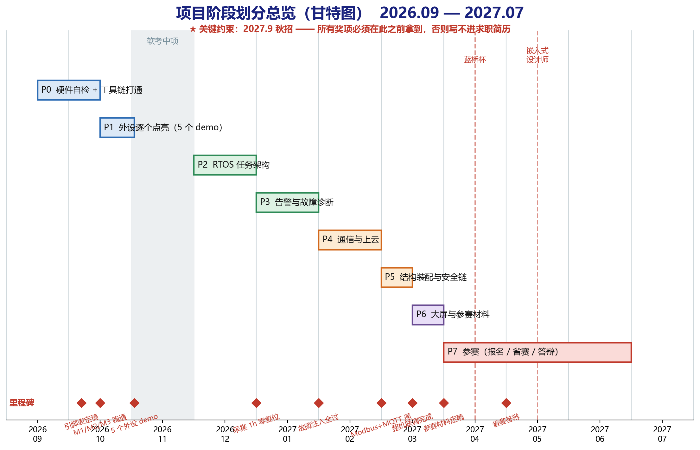
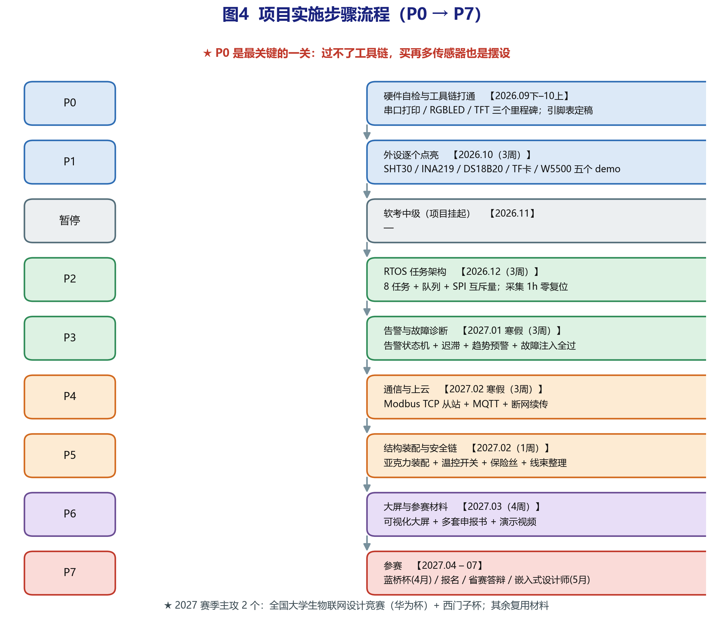

# 开发计划

## 目标与范围

**交付时间：2027 年 3 月底，全部功能。**

| 模块 | 内容 |
|---|---|
| 采集 | 双路温度（SHT30 ×2）、负载本体温度（DS18B20）、负载电流与电压（INA219）、输出占空比 |
| 本地逻辑 | 三级告警状态机、六条故障判据、加热闭环控制 |
| 显示 | 2.4" ILI9341 SPI 屏，LVGL 界面，XPT2046 电阻触摸 |
| 存储 | 板载 TF 卡 + FatFS，环形日志，断网续传 |
| 通信 | Modbus RTU（串口）、Modbus TCP（W5500）、MQTT |
| 上位机 | 云平台对接、可视化大屏 |
| 启动 | 外部 QSPI Flash XIP |
| 保护 | PPTC + KSD9700 温控开关 + 独立看门狗 |

## 时间账

工时估算约 17 周。开发板 2026 年 9 月 14 日到货，从那天起算可用时间：

| 时段 | 可用 | 说明 |
|---|---|---|
| 9/14 – 10/31 | 7 周 | 正常开发 |
| 11/1 – 11/10 | 0 | 软考中级 |
| 11/11 – 12/20 | 5.7 周 | 正常开发 |
| 12/21 – 1/10 | 0.5 周 | 期末考试 |
| 1/11 – 2/20 | 3 周 | 寒假，已扣春节 |
| 2/21 – 3/31 | 3 周 | 春季学期，按课业占一半折算 |
| **合计** | **19.2 周** | |

17 周的活对 19.2 周的时间，**余量约两周**。

这两周不要提前分配掉，留着吃调试意外。

## 阶段安排

| 时间 | 阶段 | 内容 | 验收条件 |
|---|---|---|---|
| 9/14 – 9/28 | P0a | 工具链、串口打印、RGBLED | 两个里程碑跑通 |
| 9/29 – 10/12 | P0b | QSPI 启动、下载算法、TFT 点亮 | 程序跑在外部 Flash 上 |
| 10/13 – 10/31 | P1 | SHT30、INA219、DS18B20、W5500 逐个点亮 | 每个外设读数合理 |
| 11/1 – 11/10 | — | 软考 | — |
| 11/11 – 11/24 | P2 | FreeRTOS 八任务、队列、互斥量、看门狗 | 连续跑 1 小时零复位 |
| 11/25 – 12/8 | P3 | 算法上板、故障注入 | 六类故障全部命中且无误报 |
| 12/9 – 12/20 | P4a | Modbus RTU | 寄存器读写正确 |
| 12/21 – 1/10 | — | 期末考试 | — |
| 1/11 – 1/24 | P4b | W5500、Modbus TCP | 网络通信打通 |
| 1/25 – 2/7 | P4c | MQTT、云平台对接 | 数据上云 |
| 2/8 – 2/21 | P5 | TF 卡、环形日志、断网续传 | 断网补传验证通过 |
| 2/22 – 3/14 | P6 | LVGL 移植、界面、触摸校准 | 界面可用 |
| 3/15 – 3/24 | P7 | 整机装配、安全链验证、演示视频 | 整机可演示 |
| 3/25 – 3/31 | P8 | 上位机大屏、申报材料 | 材料定稿 |

## 缓冲的使用

那两周余量留到 3 月中旬再动。

QSPI 启动、W5500 网络、LVGL 移植这三个环节最容易超时——
它们的共同点是依赖外部条件（厂商下载算法、网络环境、第三方库），
不像自己写的代码那样可控。

如果到 3 月中旬发现落后超过两周，按这个顺序砍：

1. 上位机大屏 → 改用现成的 Modbus 调试工具演示
2. 云平台可视化 → 保留 MQTT 上报，不做大屏
3. LVGL → 退回自己写的简单绘图
4. 断网续传 → 保留本地日志，去掉补传逻辑

每砍一项，功能上都有替代，作品本身不会残废。

## 风险

**QSPI 下载算法。** 这是唯一还需要厂商资料的地方，
而正点原子的资料只有百度网盘一个源。应对：先用片内 128KB Flash
推进 P0a 和 P1，同时挂网盘下载；到 P0b 时如果还没拿到，
P0b 往后挪，先做 P1。

**调试的不确定性。** 上表是"顺利情况"的估算。
上面提到的三个环节，任何一个卡住都可能多花一周以上。

**考试期间的断档。** 软考和期末各一到两周完全不开发。
损失不只是时长，还有上下文——重新捡起来要花时间。
应对：停之前把当前进度和下一步写到 `notes/` 里，回来直接看。

## 关于后期复习

全功能代码量在万行量级，不可能要求全部记住。每个模块的说明分三层留：

1. **代码注释**：写"为什么这么做"，不是"做了什么"
2. **设计文档**（`docs/`）：接口、参数依据、关键取舍
3. **答辩问答手册**：按评委可能提的问题组织，
   每个问题指向具体代码位置和文档章节

三层随代码一起产出，不单独补。

## 当前状态

已完成：硬件选型与免焊方案、引脚分配与接线工程图、算法层代码、
PC 端验证 11 项全部通过、工程骨架与文档。

未开始：工具链未验证、外设驱动未写、RTOS 集成未做。

开发板 2026 年 9 月 14 日到货，当天可以开始 P0a。
