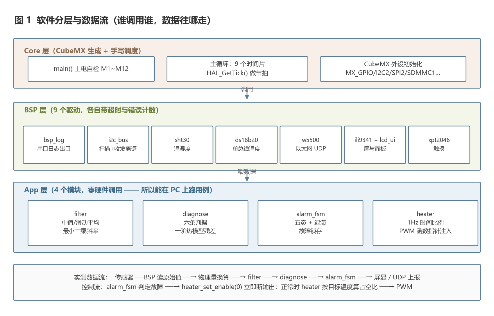
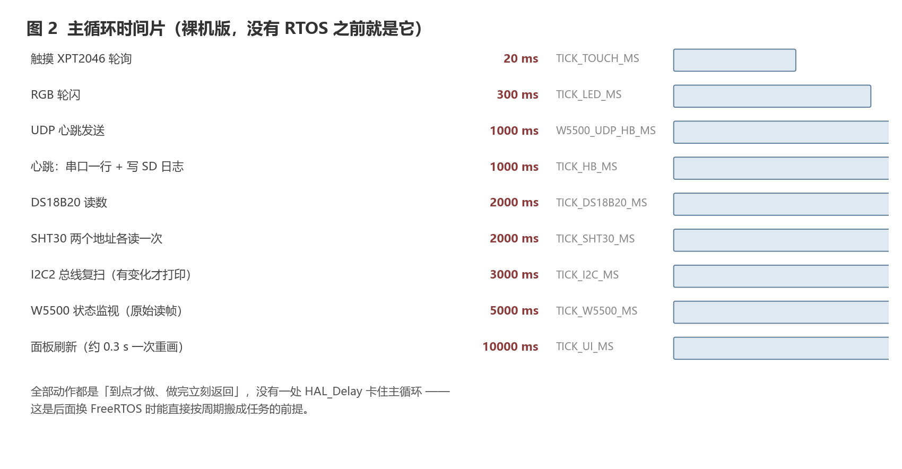
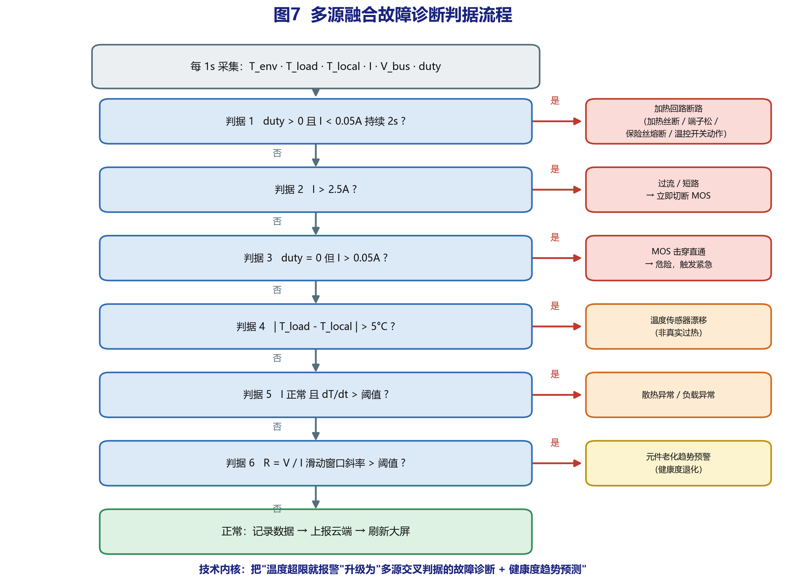
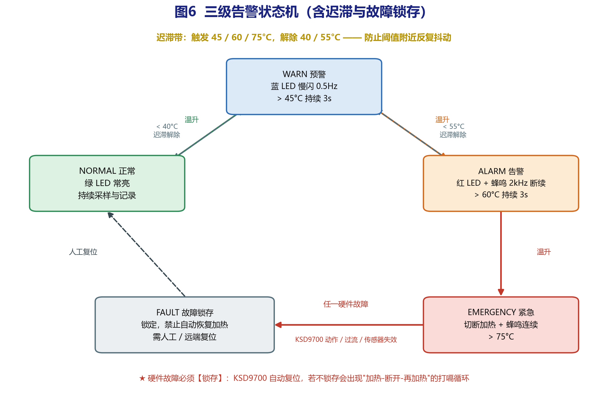
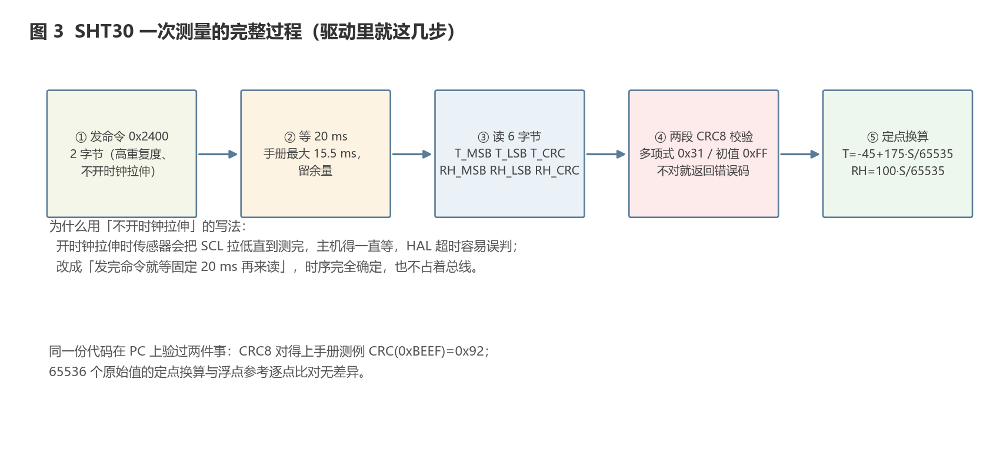

# 控制柜监测告警系统 · 技术说明

**版本**：2026-10-20（对应提交 `979debd`，固件 hex `a2caa050…`）
**用途**：给自己复盘用。按「为什么这么设计 → 代码在哪 → 判据是什么 → 怎么验证」的顺序写，不按教程顺序。

---

## 0. 怎么读这份文档

这份文档只写**已经在板上跑通**的东西。没做的单独列在第 10 节，不混进来。

读的顺序建议：第 1 节知道项目要解决什么问题，第 2、3 节知道代码长什么样，第 4、5 节知道程序怎么跑起来，第 6 节按模块核对实现，第 7 节是最值钱的算法层，第 8 节把数据流串一遍，第 9 节是验证方法。

如果只有十分钟，看第 1 节、第 7 节、第 9 节。

---

## 1. 项目要解决什么问题

电气柜（配电柜、通信机柜这类）里通常有加热器防潮。常规监测做法是给温度设一个上限，超了就报警。这个做法有两个硬伤：

1. **报警时故障已经成立**——等温度真的超了，柜里已经在出问题；
2. **分不清是哪一类故障**——加热器正常工作、散热通道失效、温度探头漂移，这三种情况温度都会往上走，只看温度值区分不了。

本项目的做法：**同时看温度、加热回路电流、加热输出占空比，用不同物理量互相印证。**

逻辑很直接：电流正常说明负载确实在耗电，那么温升速度就应该落在由功率决定的一个范围内。

- 实测温升明显快于这个范围 → 散热通道出了问题；
- 实测温升几乎为零而电流正常 → 热偶或导热路径断了；
- 两路温度探头读数差距过大 → 探头自己漂移了；
- 有占空比却测不到电流 → 回路断了（加热丝、端子、保险、温控开关）。

这就是整个项目的技术内核：**把「温度超限就报警」升级成「多源交叉判据 + 健康度趋势」**。

---

## 2. 硬件与资源现状

| 项 | 值 |
|---|---|
| 主控 | 正点原子 MiniPro STM32H750VB（Cortex-M7，片内 Flash 仅 128 KB） |
| 系统时钟 | SYSCLK 480 MHz，HCLK 240 MHz，APB1/2 120 MHz |
| 编译器 | Keil MDK + ARM Compiler 6（AC6），优化档 -O7（体积优先，逐档实测过） |
| 固件占用 | Code+RO+RW = **40876 字节（39.9 KB / 128 KB，31%）**，RW+ZI = 3736 字节 |
| 算法层验证 | `bash code/pc_test/build_run.sh`，11 项用例全过 |

**外设清单与状态**

| 外设 | 接口 | 引脚 | 状态 |
|---|---|---|---|
| USART1（日志，板载 CH340） | UART | PA9 / PA10 | 已验 |
| RGB 灯 红/绿/蓝 | GPIO | PB4 / PE6 / PE5（低电平亮） | 已验 |
| microSD | SDMMC1 四位 | PC8~PC11=D0~D3、PC12=CK、PD2=CMD | 已验（15193 MB） |
| ILI9341 屏 | SPI2（Mode 0） | PB13=SCK / PB15=MOSI / PB12=CS / PE0=RST / PE1=DC | 已验 |
| XPT2046 触摸 | 位翻转软件 SPI | PC3=CS / PB14=CLK / PA3=DIN / PC0=DO | 已验 |
| W5500 以太网 | SPI2 共用（片选 PA8） | PB13/PB15/PB14 + PA8 | 已验（UDP 双向） |
| DS18B20 | 1-Wire（板载 U11 座） | PC13 | 曾验通，当前拆下 |
| SHT30 ×2 | I2C2 400 kHz | PB10=SCL / PB11=SDA | #1 已验，#2 待接 |
| INA219（电流） | I2C2 | 同上 | 未接 |

注意两件事：**SPI2 是屏和 W5500 共用的**（各自有片选），这是后面上 RTOS 必须做互斥的原因；I2C2 上还挂着板载 EEPROM，扫描时会看到 `0x50~0x57` 一整段（是同一颗芯片的多个页地址，不是 8 个器件）。



---

## 3. 软件分三层

### 3.1 目录与职责

```
code/
  Core/            CubeMX 生成 + 手写调度（main.c）
  Drivers/BSP/     9 个驱动模块，各自一个目录
    common/        bsp_log —— 串口日志出口（打印整数/十六进制/定点小数）
    i2c_bus/       I2C2 扫描 + 带超时的收发原语
    sht30/         温湿度（单次测量 + 双 CRC8）
    ds18b20/       单总线温度（位翻转时序）
    w5500/         以太网（SPI2 + socket0 UDP）
    ili9341/       屏驱动（命令/数据、矩形填充、字模绘制）
    lcd_font/      8×16 ASCII 字模
    lcd_ui/        控制柜面板（静态框 + 数值刷新）
    xpt2046/       触摸（位翻转软件 SPI + 标定）
  App/             4 个算法模块，零硬件调用
    filter.c       中值滤波 / 滑动平均 / 最小二乘斜率
    diagnose.c     六条判据 + 一阶热模型残差
    alarm_fsm.c    五态告警状态机（迟滞 + 锁存）
    heater.c       1 Hz 时间比例加热控制（PWM 用函数指针注入）
  pc_test/         PC 端用例（把 App 层直接编进 gcc 程序跑）
```

### 3.2 为什么 App 层一行硬件代码都不许有

因为**要能在电脑上验证**。`code/pc_test/build_run.sh` 用 gcc 把四个 App 模块 + 一个测试主程序编成普通 PC 程序，连 `stm32h7xx_hal.h` 都不包含。好处：

- 改算法不用烧板子，秒级验证；
- 可以构造真实硬件造不出来的场景（比如"80 ℃ 持续 3 秒"、"阻值每秒涨 0.2 Ω"）；
- 同样的输入每次结果一致，便于回归。

代价是要在接口上做解耦设计：`heater.c` 输出 PWM 不用 `HAL_GPIO_WritePin`，而是用函数指针 `pwm_set_fn` 注入——板子上注入真 PWM，PC 上注入一个只记录数值的假函数。

---

## 4. 上电自检序列（M1–M12）

`main()` 里在进主循环前按顺序跑一遍自检，每段都打串口、都有明确判据。这是排查硬件最快的入口。

| 段 | 干什么 | 判据（串口该出现什么） |
|---|---|---|
| M1 | 打印 MCU/时钟/波特率 | `MCU : STM32H750VBTx`、`SYSCLK : 480000000 Hz` |
| M2 | RGB 三色轮闪 | 红→绿→蓝各亮一次 |
| M4 | 屏自检：红绿蓝黑各 0.4 s | `TFT LCD : init OK  SPI err total=0` |
| M5 | 画面板静态框 + 占位数值 | `TFT UI : panel drawn` |
| M6 | 触摸自检（可选向导/五点验收） | `XPT cal : x 241..3805  y 3875..256  swap=0` |
| M8 | W5500 读版本寄存器 | `VERSIONR=0x00000004`（SPI 三线 + 片选 + 帧格式全对） |
| M9 | 静态 IP + socket0 UDP 打开 | `net cfg OK`、`udp open OK  port 5000` |
| M10 | DS18B20 读 ROM + 一次温度 | `DS18B20: ROM=28BD…`（8 字节 ROM + CRC 过） |
| M11 | I2C2 扫描 0x08~0x77 | `I2C2 bus : scan … -> N device(s): …` |
| M12 | SHT30 两个地址各读一次 | `SHT30 @0x44: T=27.585 C  RH=55.535 %` |
| M3 | SD 卡 + FATFS 挂载、目录、写读回验 | `FATFS write: 34 bytes` → `read : OK, content matches` |

**为什么自检要放这么细**：每个外设单独一段、单独一条判据，出问题时从串口就能定位到"哪一层的哪个环节"，不用连调试器。比如屏不亮但 `SPI err total=0`，说明字节确实发出去了，问题在物理接线，不在代码——这条判据救过一次（当时是 MOSI 那根线松了）。

---

## 5. 主循环：9 个时间片

裸机阶段没有 RTOS，全部动作靠 `HAL_GetTick()` 做非阻塞时间片：到点才执行一次，做完立刻返回。



| 周期 | 变量 | 干什么 |
|---|---|---|
| 20 ms | `t_touch` | 触摸轮询（跟手的关键；20 ms ≈ 50 Hz） |
| 300 ms | `t_led` | RGB 轮闪 |
| 1000 ms | `t_udp` | UDP 心跳发送（失败/恢复只在转折点打印） |
| 1000 ms | `t_hb` | 心跳：串口一行 + 追加写入 `0:/LOG.TXT` |
| 2000 ms | `t_ds` | DS18B20 读数 |
| 2000 ms | `t_sht` | SHT30 两个地址各读一次 |
| 3000 ms | `t_i2c` | I2C2 复扫（器件增删才打印） |
| 5000 ms | `t_w5` | W5500 状态监视（原始读帧 + 错误计数） |
| 10000 ms | `t_ui` | 面板刷新（重画一次约 0.3 s） |

关键约束：**任何一处都不许用 `HAL_Delay` 卡住主循环**。这条纪律是后面能平滑换 FreeRTOS 的前提——每个时间片天然对应一个任务。

---

## 6. BSP 层九个模块的要点

| 模块 | 关键实现 | 判据 / 踩过的坑 |
|---|---|---|
| `common/bsp_log` | 全局函数指针注入日志出口，没设置过就静默丢弃，不会崩 | 数字打印统一走这里，串口字符串全 ASCII（XCOM 按 GBK 解码） |
| `i2c_bus` | `HAL_I2C_IsDeviceReady` 逐地址探测，单次 5 ms 超时；收发原语 100 ms 超时 + 错误计数 | 空总线也能几毫秒扫完，不会卡死 |
| `sht30` | 单次测量 0x2400（高重复度、不开时钟拉伸）+ 等 20 ms + 读 6 字节 + 双 CRC8 | 见第 8 节时序图 |
| `ds18b20` | 位翻转 1-Wire，PC13 在运行时配成开漏输出，不依赖 CubeMX 配置；每个时隙内关中断几十微秒 | ROM 的 CRC 必须用**残差式**（对含 CRC 的 8 字节算 CRC 应等于 0），写成"等于 ROM[7]"会恒不成立 |
| `w5500` | 帧格式：地址 3 字节 + 控制字节（BSB 在 bit7:3、读写位在 bit2）；socket0 做 UDP；错误计数分 SPI 失败与有界等待超时两类 | 控制字节曾整帧写错，导致读 VERSIONR 恒为 0；`MISO` 悬空时软件全绿但设备不动 |
| `ili9341` | 初始化序列照厂商 F429 例程；MADCTL 定死 0x08；矩形填充 + 字模绘制 | 字母全镜像的根因是**字模位序**（应 `0x01<<cx` 而非 `0x80>>cx`），MADCTL 不用改；查这类问题要离线渲染成 ASCII 图，别在板上试 |
| `lcd_font` | 8×16 ASCII 点阵 | — |
| `lcd_ui` | 静态框一次画好，之后只刷数值区域；`lcd_ui_repaint()` 用于擦掉临时图形 | 一次全屏重画约 0.3 s，所以面板刷新周期给到 10 s |
| `xpt2046` | 位翻转软件 SPI（SCLK 上限约 2 MHz，与屏的 6 MHz 不同，所以没并到同一条总线） | 这块面板 **raw Y 与屏幕 Y 反向**；判「按没按下」只能看 Y（空闲时 X 与点击左侧重合）；标定值只对本块屏有效 |

---

## 7. App 层：四条判据从哪来

### 7.1 六条判据

| 编号 | 判据 | 对应故障 | 动作 |
|---|---|---|---|
| 1 | `duty > 0 && I < 0.05 A` 持续 2 s | 加热回路断路 | 停输出，锁存 |
| 2 | `I > 2.5 A` | 过流 / 短路 | 立即切断，锁存 |
| 3 | `duty == 0 && I > 0.05 A` | MOS 管击穿直通 | 报警，锁存 |
| 4 | 两路温度均 > 45 ℃ 且 \|ΔT\| > 5 ℃ | 温度探头漂移 | 降级单探头工作 |
| 5 | 实测温升速率 − 模型预测 > 0.5 ℃/s | 散热通道异常 | 报警 |
| 6 | `d(R)/dt > 0.05 Ω/s`，`R = U/I` | 加热元件老化 | 趋势预警 |



### 7.2 判据 5 为什么必须用模型，不能用固定斜率

固定阈值在物理上不成立：10 W 功率加热一个 9 J/K 的负载，正常温升速率本来就有 0.5 ℃/s 左右。任何"超过某个速率就报警"的判据都会一直误报。

所以基准要由模型给：

```
预测温升速率 = ( Pmax × 占空比 − k × (T − Tamb) ) / C
残差        = 实测温升速率 − 预测温升速率
残差 > 0.5 ℃/s  →  判散热异常
```

其中 C 是负载热容（J/K）、k 是散热系数（W/K）。当前代码里 `C = 9.00`、`k = 0.080`、`Pmax = 10.0` 是**初值估算**，等功率级接上、INA219 通了以后要重新做参数辨识（给恒定功率、记录温度曲线、拟合）。这三个数不准，判据 5 就是错的——这是目前已知的最大不确定性。

### 7.3 五态状态机



- 向上迁移：45 / 60 / 75 ℃，每级要**持续 3 s** 才认（去抖）；
- 向下解除：40 / 55 ℃（迟滞 5 ℃，防止在阈值附近来回抖）；
- 硬件故障（过流、MOS 击穿、温控开关动作、传感器失效）→ **`FAULT` 锁存**，必须人工或远端复位；
- 为什么必须锁存：KSD9700 这类温控开关会自动复位，不锁存就会出现"加热 → 断开 → 自动复位 → 再加热"的打嗝循环，反而更危险。

### 7.4 加热控制

1 Hz 时间比例控制：每秒算一次占空比，误差 ≥ 5 ℃ 时全功率，接近目标时按比例输出。占空比满量程 10000（分辨率 0.01%）。PC 端用一阶热模型仿真 200 秒，收敛到 49.04 ℃（目标 50 ℃，误差 −0.96 ℃）。

---

## 8. 一次完整的数据流

以 SHT30 为例，从"发命令"到"屏幕上出现数字"：



1. `sht30_read()` 调 `i2c_bus_write()` 发 2 字节命令 `0x2400`；
2. `HAL_Delay(20)`——手册最大 15.5 ms，留余量。**这里用"固定等待"而不是"时钟拉伸"**，原因是开时钟拉伸时传感器会把 SCL 拉低，主机得一直等，HAL 的超时判断容易误判；
3. `i2c_bus_read()` 读 6 字节：`T_MSB T_LSB T_CRC RH_MSB RH_LSB RH_CRC`；
4. 两段 CRC8 校验（多项式 0x31、初值 0xFF、不反射），不对就返回错误码（3 = 温度 CRC 错、4 = 湿度 CRC 错）；
5. 定点换算成 0.001 精度：`T = −45 + 175 × S / 65535`、`RH = 100 × S / 65535`（中间量用 int64，避免溢出）。

之后再往上走：`filter` 做滑窗 → `diagnose` 算残差和阻值斜率 → `alarm_fsm` 决定状态 → `lcd_ui` 刷屏 / `w5500` 上报。

---

## 9. 怎么验证（这套方法比结论更重要）

| 层 | 方法 | 判据 |
|---|---|---|
| 算法层 | `bash code/pc_test/build_run.sh`（gcc） | `PASS = 11  FAIL = 0` |
| 算法层（数学） | 把 CRC8 与换算表达式从源码**原样抽出来**编到 PC 上跑 | CRC(0xBEEF)=0x92 与手册一致；65536 个值定点 vs 浮点无差异 |
| 固件层 | `UV4.exe -b <uvprojx> -j0` | **退出码 0**（0 = 无错无警告），不看屏幕 |
| 烧写前 | hex 地址区间检查 | 单段 `0x08000000 ~ 0x08009FB0`，入口 `0x08000299`，与 `.map` 的 Total ROM 对得上 |
| 只改注释 | 重建后比 hex 的 SHA256 | 相同则已烧的板子不用重烧 |
| 编码 | `python notes/tools/_check_main_encoding.py` | 看**字节**：BOM 在不在、CRLF 纯不纯，不看屏幕上有没有乱码 |
| 硬件层 | 每项都有串口判据（见第 4 节表格） | — |

---

## 10. 踩坑清单（挑最费时间的十条）

1. **CubeMX 重新生成会吞代码**：写在 `USER CODE BEGIN/END` 标记**之外**的代码属于它的地盘，一次吞掉过 204 行（触摸整段 + 7 个计时变量）。现在所有自写代码都在圈内，且 `scripts/post_generate.py` 会检查关键符号还在不在。
2. **没有 BOM 时 CubeMX 按 GBK 读、会截断中文注释**。而 **Keil 关窗保存会把 BOM 吃掉**（实测 2026-10-20），所以每次开关 Keil 后要跑一次编码检查。
3. **µVision 保存会把 `.uvprojx` 整篇重排**（`<X/>` → `<X></X>`，800 行噪音）。现在仓库跟着它的格式走，等价性用"重建后 hex 相同"证明。
4. **屏字镜像 ≠ 显示方向错**：字模位序（`0x01<<cx`）与 MADCTL（0x08）是两个独立自由度，混了就会修错地方。
5. **DS18B20 ROM 的 CRC 判据要写残差式**（== 0），写成 `== rom[7]` 恒不成立。
6. **W5500 帧格式的控制字节**：BSB 在 bit7:3、读写位在 bit2，写错就整帧失效、VERSIONR 恒 0。
7. **"软件全绿、设备不动"是物理层故障**：MOSI 一根线松了，`HAL_SPI_Transmit` 照样返回 OK。
8. **触摸 panel 的 raw Y 与屏幕 Y 反向**，且空闲时 X 与"点击左侧"的 X 重合——判按下只能看 Y。
9. **Intel HEX 的 `LL` 是长度不是地址高字节**，读错会算出 79.8 KB 的假区间（真值 39.9 KB），交叉核对 `.map` 才发现。
10. **MinGW 的 gcc 处理不了含中文的工程路径**（cc1 报文件找不到），含中文路径的工程要在 WSL 里编；另外 **360 会把刚编出来的 exe 当场掐掉**（`WinError 5`），临时验证跑 WSL 里的 gcc。

---

## 11. 当前进度与下一步

**已实板验证**：工具链 / SWD / 串口 / GPIO、SD + FatFs、心跳落卡、ILI9341 屏、XPT2046 触摸、W5500（UDP 双向、静态 IP）、DS18B20、I2C2 总线扫描、SHT30 #1（双 CRC 全过，T=27.6 ℃）。

**未完成**

| 项 | 说明 |
|---|---|
| SHT30 #2 | 只需把 `ADDR` 接 3V3，地址变 0x45 |
| INA219 | 驱动未写；写之前必须先看模块上分流电阻丝印（`R100`=0.1 Ω / `R050`=0.05 Ω），它决定校准寄存器 |
| 算法接真数据 | 目前面板上的数值是占位值，四个算法模块还没接实测输入 |
| FreeRTOS | 8 个任务划分、SPI2 互斥、`ffconf.h` 重入 |
| 通信协议 | 告警帧（魔数/版本/长度/校验/源过滤）、Modbus TCP、断网续传 |

**一个未结案的悬案**：W5500 的错误计数曾在一拍之内从 0 跳到 635。按代码，"有界等待超时"最快 10 次/秒，凑不出 635，所以更像是 SPI 事务立即失败（总线被扰动）。当时有公网杂包打进来。这条正好留作 FreeRTOS 做 SPI2 互斥时的复现素材：先不加互斥跑 1000 次看计数，再加上再跑一次。

**注意**：`images/任务架构图.png` 那张图是**计划图**，不是现状——上面有 8 个还没实现的 FreeRTOS 任务，而且写着 LVGL（已决定不用）。别拿它当现状对照。

---

## 附录：常用命令

```bash
# 算法层用例（在 WSL 或装了 gcc 的机器上）
bash code/pc_test/build_run.sh

# 固件全量重建（命令行，判据看退出码）
"D:/Keil/UV4/UV4.exe" -b code/MDK-ARM/CabinetGuardian.uvprojx -j0

# CubeMX 重新生成后的自检（幂等，健康工程上是空操作）
python scripts/post_generate.py

# main.c 编码检查（看字节，别靠眼睛）
python notes/tools/_check_main_encoding.py

# 重新生成本文档的插图
python scripts/doc_figures.py
```
