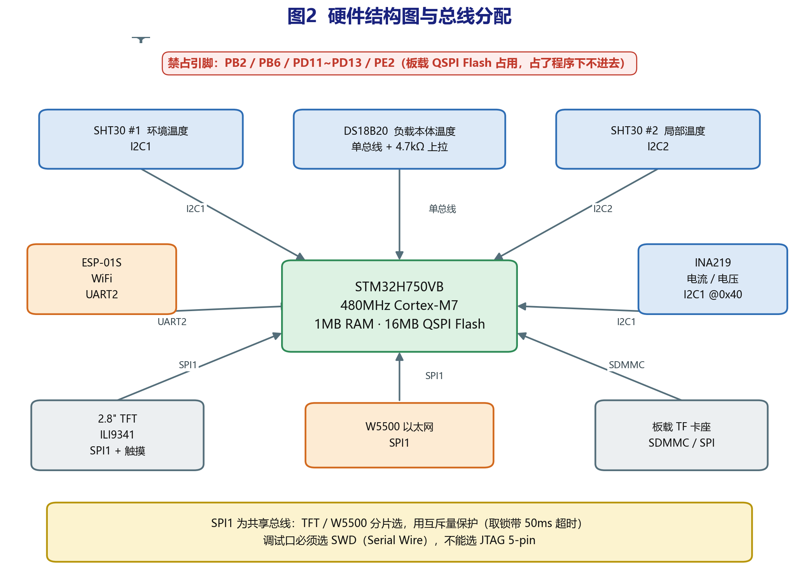
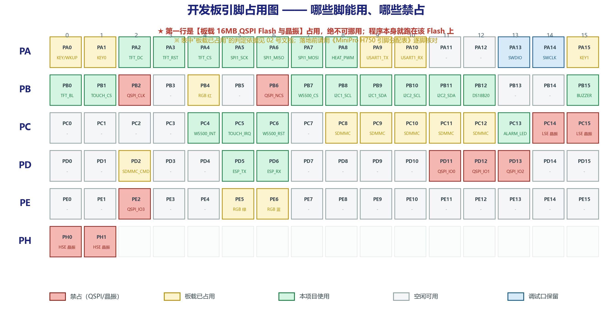
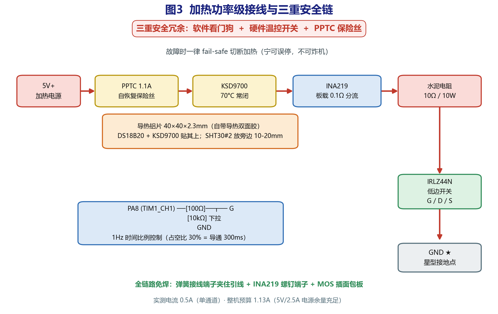
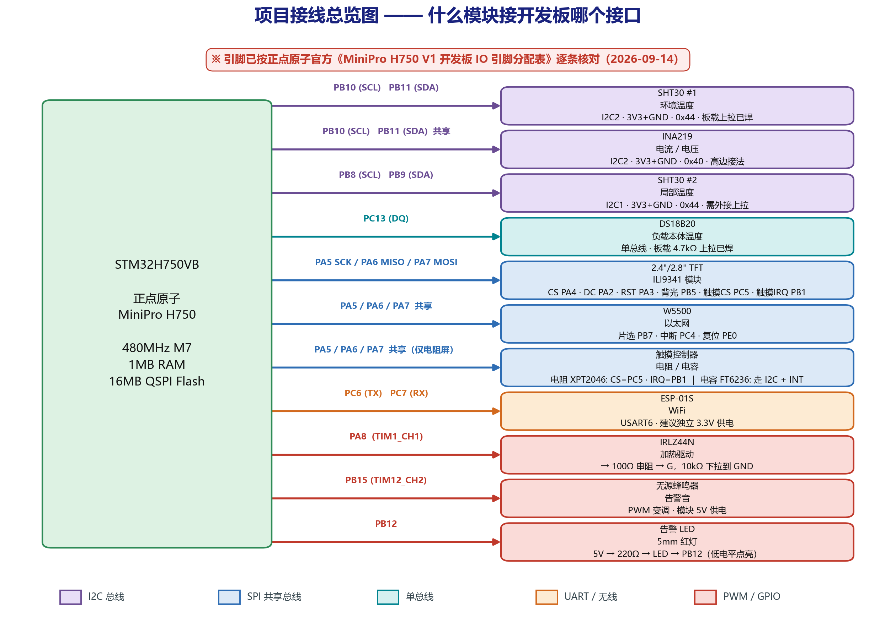
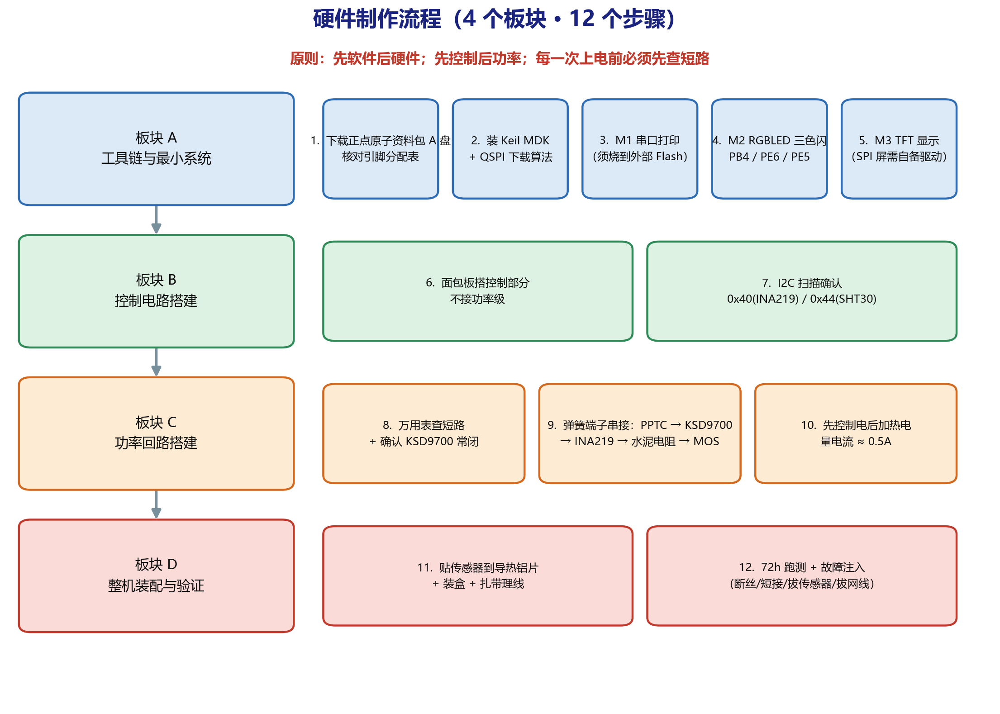
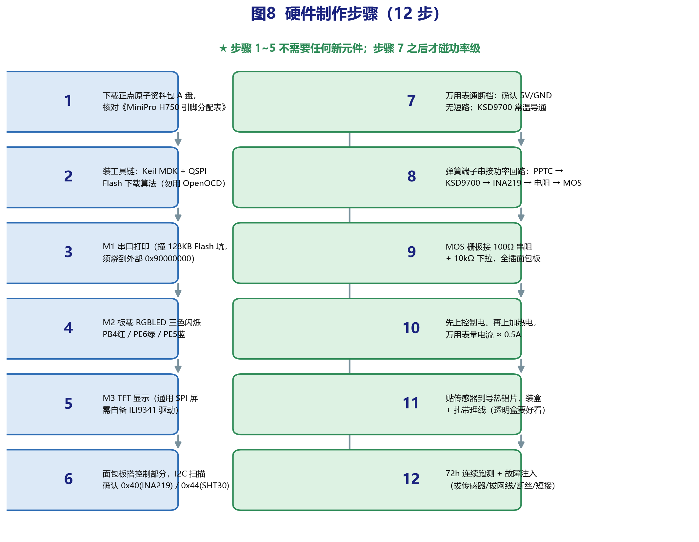

# 硬件设计

## 主控

正点原子 MiniPro H750，主控 STM32H750VBT6（LQFP100，Cortex-M7）。

这颗芯片有两个和常规 STM32 不一样的地方，直接影响工程组织方式：

**片内 Flash 只有 128KB。** 而片上有 1MB RAM，内存分成五块：

| 区域 | 起始地址 | 大小 |
|---|---|---|
| ITCMRAM | 0x00000000 | 64KB |
| DTCMRAM | 0x20000000 | 128KB |
| AXI SRAM (RAM_D1) | 0x24000000 | 512KB |
| RAM_D2 | 0x30000000 | 288KB |
| RAM_D3 | 0x38000000 | 64KB |

**板上另有一片 16MB 的 QSPI Flash（博雅 BY25Q128）**，映射在 0x90000000，
正点原子的例程默认把程序放这里，用 XIP 方式执行。

这带来一个取舍。跑在 QSPI 上意味着程序规模不受限，但需要额外的下载算法
（`STM32H750VB_25QXX@ALIENTEK.FLM`）才能烧写，调试链路更长。

本项目的处理方式是**全程跑片内 128KB Flash，不用 QSPI**。支撑这个决定的
是选型上避开了两个最吃空间的库：

- W5500 是硬件协议栈芯片，TCP/IP 在芯片内部完成。固件这边只是通过 SPI
  读写它的 socket 寄存器，不需要移植 lwIP。
- 界面自己写绘图和字库，不引入 LVGL。

粗算：FreeRTOS 约 15KB，HAL 加各外设驱动约 30KB，W5500 驱动加 Modbus
从站约 15KB，绘图和字库约 15KB，合计 75KB 上下，128KB 装得下。

代价是界面只能做简单图形，做不了动画和复杂控件。如果后续确实需要 LVGL，
再切到外部 QSPI，那时才需要下载算法。



## 不可用引脚

QSPI Flash 占用以下引脚，复用功能是硬件固定的，不能挪作他用：

```
PB2   QSPI_CLK
PB6   QSPI_NCS
PD11  QSPI_IO0
PD12  QSPI_IO1
PD13  QSPI_IO2
PE2   QSPI_IO3
```

另外这些引脚被板载外设占用：

| 引脚 | 板载用途 |
|---|---|
| PA0 / PA1 / PA15 | 三个用户按键（WK_UP / KEY0 / KEY1） |
| PB4 / PE6 / PE5 | RGB LED（红 / 绿 / 蓝） |
| PA9 / PA10 | CH340C 串口 |
| PC8–PC12、PD2 | 板载 TF 卡座（SDMMC） |
| PH0 / PH1 | 外部高速晶振 |
| PC14 / PC15 | 外部低速晶振 |

**调试口必须用 SWD，不能用 JTAG。** 板上把 PA15（JTDI）和 PB4（NJTRST）
当普通 GPIO 用了（按键和红灯），选 JTAG 会占用这两个脚，
导致 KEY1 和红灯失灵。



## 引脚分配

| 引脚 | 功能 | 连接对象 | 依据 |
|---|---|---|---|
| PA2 | TFT_DC | TFT 模块 DC | 不插 ATK MODULE 时完全独立 |
| PA3 | TFT_RST | TFT 模块 RESET | 同上 |
| PA4 | TFT_CS | TFT 模块 CS | 不插 OLED/CAMERA 时独立 |
| PA5 | SPI1_SCK | TFT / 触摸 / W5500 共用 | |
| PA6 | SPI1_MISO | 同上 | |
| PA7 | SPI1_MOSI | 同上 | |
| PA8 | TIM1_CH1 | 加热控制，经 100Ω 到 MOS 栅极 | 板上接了红外接收头，仅作输出用 |
| PA9 / PA10 | USART1 | 板载 CH340C，调试串口 | 由 P5 跳线选择是否接 CH340 |
| PA13 / PA14 | SWDIO / SWCLK | ST-Link | |
| PB1 | GPIO 输入 | 触摸中断 T_IRQ | 板载触摸 PEN 脚，不插模块时独立 |
| PB5 | TIM3_CH2 | TFT 背光（PWM 调光） | 板载 LCD 接口背光脚 |
| PB7 | GPIO 输出 | W5500 片选 | 独立 |
| PB8 / PB9 | I2C1 | SHT30 #2 | 独立，需外接 4.7kΩ 上拉 |
| PB10 / PB11 | I2C2 | 24C02 + SHT30 #1 + INA219 | 板载总线，4.7kΩ 上拉已焊 |
| PB12 | GPIO 输出 | 告警 LED | 独立 |
| PB15 | TIM12_CH2 | 无源蜂鸣器（PWM 变调） | 不插 WIRELESS 模块时独立 |
| PC4 | GPIO 输入 | W5500 中断 | 独立 |
| PC5 | GPIO 输出 | 触摸片选 T_CS | 板载触摸 CS 脚 |
| PC6 / PC7 | USART6 | ESP-01S | 独立，PC6 是 TX、PC7 是 RX |
| PC13 | 单总线 | DS18B20 数据线 | 板载单总线接口，4.7kΩ 上拉已焊 |
| PE0 | GPIO 输出 | W5500 复位 | 独立 |

几点说明：

**I2C 拆成两条总线。** 板载 24C02 挂在 PB10/PB11 上（板子上已经焊了 4.7kΩ 上拉），
这条总线直接复用，挂 SHT30 #1 和 INA219，不用自己加电阻。SHT30 #2 单独走
PB8/PB9 这条 I2C，两个温度探头物理隔离，避免一条总线挂了两个都读不到。
PB8/PB9 需要外接上拉，不过多数 SHT30 模块板上自带。

**DS18B20 走 PC13。** 板子上有一个单总线接口（U11），带 4.7kΩ 上拉，
专为 DHT11/DS18B20 准备的。用它省掉自己加电阻的麻烦。

**ESP-01S 走 USART6。** 最初打算用 PD5/PD6 当 USART2，但这两个脚被
FMC 总线和触摸接口占了。PC6/PC7 是独立引脚，复用为 USART6 正好。

**告警 LED 走 PB12，不用 PC13。** PC13 让给 DS18B20 了。PB12 是 SPI2 的片选，
板上没接任何器件，完全独立。

**板载蜂鸣器（PE4）是有源的，只能响不能变调。** 想要告警音有节奏变化，
用 PB15 接外部的无源蜂鸣器模块；不介意单调的话，直接用板载那个更省事。

I2C1 上挂两个从机，地址不冲突：INA219 是 0x40，SHT30 默认 0x44
（ADDR 拉高则为 0x45）。板载 AT24C02 EEPROM 在 0x50，也在同一条总线上，
用来保存触摸校准参数。

SPI1 上挂三个设备，靠各自独立的片选区分：TFT（PA4）、触摸（PB1）、
W5500（PB7）。**SPI1 是全工程唯一的共享总线，必须用互斥量保护，
且取锁必须带超时。** 用 `portMAX_DELAY` 等待会在这三个任务之间形成死锁。

速率上也有限制：ILI9341 可以到 40MHz，XPT2046 最高只有 2MHz，
W5500 走杜邦线时建议不超过 20MHz。先用 10MHz 跑通，再逐级提高。

**以上引脚号需要在板子到货后用万用表和丝印核对一遍再接线。**
特别是 PA9/PA10 是否确实被板载 CH340 占用、PB8/PB9 是否连了板载 EEPROM。

## 显示模块

选用的是一块带 PCB 转接板的 2.4 寸 ILI9341 SPI 模块，14 个 2.54mm 排针
（已焊）。板上带电平转换芯片，3.3V 和 5V 都能驱动。

注意触摸的时钟和数据线在模块内部**不与 LCD 连通**，需要在外部并联到
SCK/MOSI/MISO 上：

| 模块丝印 | 接到 | 说明 |
|---|---|---|
| VCC / GND | 3V3 / GND | |
| CS | PA4 | LCD 片选 |
| RESET | PA3 | |
| DC | PA2 | 数据/命令选择 |
| SDI(MOSI) | PA7 | |
| SCK | PA5 | |
| SDO(MISO) | PA6 | |
| LED | PB0 | 背光 |
| T_CLK | PA5（与 SCK 并联） | |
| T_CS | PB1 | |
| T_DIN | PA7（与 MOSI 并联） | |
| T_DO | PA6（与 MISO 并联） | |
| T_IRQ | PC5 | |

加上并线，这套触摸只额外占用 2 个引脚（T_CS 和 T_IRQ），
所以卖家标"最少占用 9 个 IO"是准确的。

模块上自带一个 Micro SD 卡座，和 TFT 共用 SPI。本项目不使用它
（改用主控板背面自带的 TF 卡座），其片选在模块板上已经上拉，不会干扰总线。

电阻触摸的坐标是模拟量，出厂值不准，第一次使用需要跑一次校准：
依次点击屏幕四角，固件记录原始采样值做线性映射，结果存进板载 AT24C02，
掉电不丢。

## 供电

| 电源 | 供给 | 峰值电流 |
|---|---|---|
| 5V/2.5A | 主控、显示、传感器、通信模块 | 约 0.5A |
| 5V/2A（第二路） | 加热回路，独立供电 | 约 1A |

加热回路和控制系统分开供电。共用一个电源时，加热电流会在公共地线上
产生压降，而 INA219 测的是几十毫伏量级的信号，很容易被干扰。

**地线接成星型**：所有模块的地单独引到电源地那一点，不要串联成一条链。

## 加热功率级

```
5V+ ──> PPTC(1.1A) ──> KSD9700(70°C 常闭) ──> INA219.Vin+
                                                    │
                                              [板载 0.1Ω 分流]
                                                    │
5V- <── IRLZ44N(S) <── IRLZ44N(D) <── 10Ω/10W 水泥电阻 <── INA219.Vin-
```

栅极驱动：

```
PA8 (TIM1_CH1) ──[100Ω]──> IRLZ44N 栅极
                            │
                        [10kΩ]
                            │
                           GND
```

几个关键点：

**MOS 管必须用逻辑电平型的。** 最初选的是 IRF520 模块，但那颗管子的
`Vgs(th)` 最高 4V，3.3V 栅压下工作在线性区，`Rds(on)` 约 1.5Ω，
0.5A 电流下功耗 0.38W，会发热且随温度漂移使电流读数不稳。
改用 IRLZ44N（`Rds(on)` 约 0.04Ω，同条件下功耗 0.01W）。

**栅极的 10kΩ 下拉电阻不能省。** MCU 复位期间引脚是高阻态，
没有下拉的话栅极电位不确定，MOS 可能误导通。

**IRLZ44N 是 TO-220 封装，引脚顺序要认清。** 印字面朝自己、引脚朝下时，
从左到右是栅极、漏极、源极。金属背板连着漏极，是带电的，
不装散热片，也不要让它碰到接地的东西。

**加热电阻的电流要算清楚。** 10Ω 电阻接 5V，电流 0.5A，功率 2.5W——
只有电阻额定功率的 25%，这是有意的保守取值。端子接触电阻会随插拔次数变化，
留余量比算到极限安全。

实际后果是单路加热的稳态温升约 31°C，只够触发到 ALARM 级别。
如果要演示 EMERGENCY，需要两路并联（5Ω，1A，5W，稳态温升约 62°C）。
另外 10W 水泥电阻表面温度可能超过 150°C，不能直接贴在亚克力盒内壁上，
需要固定在金属支架上悬空放置。



## 保护设计

三层，每层独立工作：

**第一层：PPTC 自恢复保险丝（1.1A）**
串联在加热回路里。过流时阻抗急剧上升切断回路，冷却后自动恢复。
选 1.1A 而不是 1.6A 或 2A，是因为 5V/2A 的电源本身给不出更大的电流，
选大规格的话保险丝永远达不到触发点，保护形同虚设。

**第二层：KSD9700 温控开关（70°C 常闭）**
双金属片结构，纯机械动作，不依赖固件。温度到 70°C 断开，约 55°C 自动闭合。

这一层的存在让固件必须处理一个特殊状态：**温控开关断开时，
MOS 命令是导通的，但回路里没有电流**——和加热丝断路的现象完全一样。
固件的判据 1 会命中，报"加热回路断路"。

问题是 KSD9700 是自动复位的。如果固件不锁存故障，
就会出现"关断 → 冷却 → 复位 → 再加热 → 再关断"的打嗝循环。
所以诊断模块一旦判定故障就置锁存位，必须人工确认才能重新使能加热。

**第三层：独立看门狗（IWDG）**
防止固件跑飞。调试阶段先不开——一下断点就复位，没法调。

## 接线规范

杜邦线按信号类型分色，排查时不用逐根追：

| 颜色 | 用途 |
|---|---|
| 红 | 电源正极（3.3V 和 5V 用深浅区分） |
| 黑 | 地 |
| 黄 | I2C SCL / SPI SCK |
| 绿 | I2C SDA / SPI MOSI |
| 蓝 | SPI MISO / 片选 |
| 白 | 中断 / 复位 |
| 棕 | PWM / GPIO 输出 |

加热回路的电流接近 1A，**不能用杜邦线**（杜邦线安全电流在 1A 以下，
且接触电阻不确定）。这一段用弹簧接线端子直接压接导线。



## 制作与装配流程

装配顺序是先控制级后功率级，每接完一部分先单独通电验证再往下走，
不要一次性全部接完再上电。





## 上电前检查

每次改完接线、上电之前过一遍：

1. 万用表通断档，量 5V 和 GND 之间，确认没有短路
2. 确认 KSD9700 处于常闭状态（常温下导通）
3. 确认 INA219 在高边（电源正极侧），装反了总线电压读到接近 0，算不出 R
4. 确认 IRLZ44N 金属背板没有碰到任何接地的东西
5. 确认加热回路的正负没有接反
6. 先只上控制部分的电，确认串口有输出、I2C 能扫到 0x40 和 0x44
7. 用万用表串联测加热电流，读数应与 `电压/电阻` 相符（理论值 0.5A）
8. 电流对得上之后再接继电器/接线端子做正式的通断测试

第 7 步不要跳过。INA219 的读数需要和万用表比对一次，
如果有系统偏差要先在固件里做标定。
